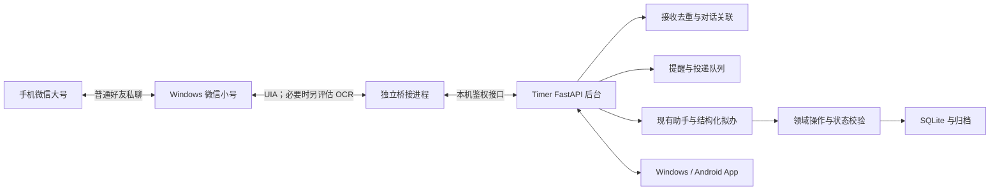

# 微信小号交互：技术路线调研与接入方案

日期：2026-10-19。状态：**用户已确认交互形态；本次完成资料调研与本机版本核查，适配器与收发均未实现、未实测。**

## 1. 目标与结论

用户在 Windows 电脑登录自己的微信小号，用手机大号与小号进行普通好友私聊。小号作为 Timer 助手，接收安排、反馈与改期请求，并主动发送开始提醒、结果追问、等待检查点和每日总结。App 保留周课表、计时、历史及同步入口，电脑后台继续是唯一权威数据源。

推荐先验证 **Windows 桌面 UI Automation（UIA）+ 独立微信桥接进程**。`Hello-Mr-Crab/pywechat` 仓库中的 **pyweixin** 是首个评估候选；若本机小号的必要控件不可读，则该候选验证不通过，另行评估 OCR 的成本与可用性。现在不将任何库列为已选定、已兼容的产品依赖。

这是一条有条件的工程路线：**电脑开机、不休眠、微信已登录、Windows 交互桌面可用，是不同条件。** 锁屏和远程桌面断开时能否完成收发，是选型的前置验收项。若实际需求包含锁屏后持续无人值守，而候选无法满足，应明确报告未达到目标，不能以“进程仍在运行”代替通过。

## 2. 本机核查与证据等级

| 项目 | 2026-10-19 核查结果 | 能说明什么 |
|---|---|---|
| Windows 微信 | `C:/Program Files/Tencent/Weixin/Weixin.exe`，文件和产品版本均为 **4.1.15.13**；卸载注册表版本一致 | 已安装版本；不代表账号可登录或 UIA 可读 |
| 用户账号和联系人 | 未检查；大号、小号身份与绑定关系待接入时确认 | 本次没有读取聊天记录或账号凭证 |
| UIA、OCR、锁屏收发 | 均未验证 | 当前不能承诺此机器已支持自动收发 |
| 调研方法 | 阅读上游 README、兼容说明、许可文件、问题记录及 GitHub 仓库元数据；读取本机安装元数据 | 未安装机器人依赖、未调整微信/系统设置、未发送消息 |

下文区分“上游声明”“上游问题报告”“本机事实”和“本项目设计建议”。问题报告不能证明所有账号都会失败，README 的版本范围也不能证明本机可用。

## 3. 候选路线比较

| 路线 | 查到的事实与依据 | 对本项目的判断 |
|---|---|---|
| **pyweixin / UIA** | 上游 QuickStart 将 pywechat 与 pyweixin 分别用于 3.9.x 与 4.x；README 声明后者支持 4.1 系列。GitHub 核查未归档，最近推送 2026-09-26。[仓库](https://github.com/Hello-Mr-Crab/pywechat)、[QuickStart](https://github.com/Hello-Mr-Crab/pywechat/blob/main/QuickStart.md) | 首个评估候选，先核查 4.1.15.13 + 小号控件，随后核查收发、身份、重复消息和桌面状态 |
| **wxauto / wxautox** | 作者当前文档描述基于 Windows UIA 的收发能力，也区分开源版与 Plus/激活更新授权。[作者文档](https://docs.wxauto.org/docs/)、[FAQ](https://docs.wxauto.org/docs/issues.html) | 可作第二候选；需要先拿到精确兼容范围、可审查版本与授权条件，不能默认免费或当前版本可用 |
| **旧 wxauto4 开源仓库** | 仓库 README 当前仅标注“停止更新”，核查最近推送为 2025-10-27。[上游仓库](https://github.com/cluic/wxauto4) | 不以旧教程中的安装命令作为当前适配依据 |
| **自建 UIA / OCR** | UIA 读取应用暴露的控件；OCR 读取可见聊天区域并配合界面操作。pyweixin 的 4.1+ 说明将 OCR 列为 UI 树不可见时的另一路线。[上游兼容说明](https://github.com/Hello-Mr-Crab/pywechat/blob/main/Weixin4.0.md) | 只需要一个私聊，可研究较小的适配范围；OCR 的联系人识别、消息边界、方向、时间和发送回显均须独立验证，成本高于“识字后点发送” |
| **Wechaty + Puppet** | Wechaty 是上层框架，实际微信接入由 Web/Pad/Windows 等不同 provider 提供。[官方 provider 文档](https://wechaty.js.org/docs/puppet-providers) | 单独安装 Wechaty 不能解决本机接入；仍要核实 provider 的维护、精确版本、费用与凭证处理。暂不增加这层依赖 |
| **WeChatFerry / Hook** | 原仓库已于 2026-07-10 归档；最近发布 v39.5.2 的配套微信为 3.9.12.51，源码含注入模块。[上游仓库](https://github.com/lich0821/WeChatFerry)、[发布记录](https://github.com/lich0821/WeChatFerry/releases) | 与本机 4.1.15.13 不匹配，维护和侵入性成本较高，不作为本轮推荐方案 |
| **本地聊天库读取 + 界面发送** | 上游有混合方案建议，但它引入另一套数据库解密/密钥依赖，且发送仍依赖桌面。[上游讨论 #300](https://github.com/Hello-Mr-Crab/pywechat/issues/300) | 不能由“只读库”推出零风险或锁屏可发送；本轮不增加全量聊天库访问范围 |
| **官方微信 ClawBot** | 腾讯插件通过扫码连接专用 Bot 会话。[官方 README](https://github.com/Tencent/openclaw-weixin/blob/main/README.zh_CN.md) | 是另一种交互入口；所查资料未提供将小号普通好友会话直接接管的能力，不能据此实现本次目标 |

pyweixin 的上游 LICENSE 标题为 LGPL 2.1，但 GitHub 元数据未识别出标准 SPDX 结果；落依赖前需核对具体 commit 的源码、包元数据与随附许可并保留记录。[LICENSE](https://github.com/Hello-Mr-Crab/pywechat/blob/main/LICENSE) 商用或付费库的许可与价格在实际采用时再核实，本次不据宣传作可用性承诺。

## 4. 会改变选型的限制

### 4.1 版本和账号共同影响 UI 可读性

上游 4.1+ 说明称，部分账号仍可看到 UI 树，部分账号不可见，旧的讲述人方式已失效；这是作者对其环境的说明，不是微信完整接口契约。[兼容说明](https://github.com/Hello-Mr-Crab/pywechat/blob/main/Weixin4.0.md)

因此必须检查小号实际的聊天标题、消息列表、输入框和发送控件。控件缺失时输出“不兼容”的诊断；不通过修改注册表、替换客户端文件或降级微信来假装适配成功。适配通过后记录微信版本、Windows 缩放、语言、库 commit；升级微信后重跑兼容检查，而非永久停用安全更新。

### 4.2 不休眠不等于锁屏可用

上游已有锁屏后 `SetCursorPos` 失败的报告，微软也说明登录桌面具有不同的权限边界。[上游 #144](https://github.com/Hello-Mr-Crab/pywechat/issues/144)、[Microsoft UIA 安全说明](https://learn.microsoft.com/en-us/windows/win32/winauto/uiauto-securityoverview)

工程上应分别测试：前台、被覆盖、最小化、熄屏但不锁定、Win+L、远程桌面断开、Windows 注销。后台调度可以持续运行，但桥接发送应在桌面不可用时暂停并显示状态，不自动解锁或关闭系统锁屏。OCR 同样不能假定拥有锁屏前的画面。

### 4.3 账号限制与桌面干扰

作者 FAQ 明确不保证个人号自动化不会受到账号或平台限制；pyweixin 仓库也有 4.1.13.12 使用后无法登录电脑的用户报告，因果和覆盖范围尚未确定。[FAQ](https://docs.wxauto.org/docs/issues.html)、[上游 #296](https://github.com/Hello-Mr-Crab/pywechat/issues/296)

小号降低与日常账号混用的影响，不能消除上述限制。桥接只面向大号这一位联系人，串行操作窗口，避免全会话扫描；用户正在操作电脑时应能暂停，不能反复抢键鼠。频率用于控制资源和打扰，不应描述为规避风控的方法。

### 4.4 身份和投递回执不是天然可靠

UI 里的昵称、备注、运行时控件编号未必是稳定微信 ID；上游也有按微信号发送的未解决问题。[上游 #284](https://github.com/Hello-Mr-Crab/pywechat/issues/284) 需要人工核对联系人详情、单次验证码绑定并存本地关系；同名、账号切换或联系人定位含糊时停止处理。若 provider 不能给出可信的稳定标识，文档和产品须明确这种身份确认的局限。

界面出现己方消息只表示本地可观察到发送结果，不能证明手机已收到或用户已读。发送后超时属于 `unknown`，不能盲目重发。重复采集一条消息与用户连续发送两条相同文本也必须区分。

## 5. 接入现有 Timer 的设计建议

这是拟议架构。当前代码尚无微信桥接、消息 inbox/outbox 或桥接专用权限。

### 5.1 保留的现有能力

- `server/app/main.py` 的 `/api/v1/assistant/messages`、拟办 apply/dismiss 接口提供现有对话流程；需要先抽出共享应用服务供 App 与桥接复用。
- 所有任务、执行与反馈修改继续落成现有 `operations` 和不可变事件。桥接不直接写状态 JSON，不持有模型 Key，不另建一份日程真相。
- `server/app/maintenance.py` 当前仅处理执行到点；`reports.py` 提供确定性报告与原文归档；`apps/planner/lib/reminders.dart` 在客户端推导提醒。服务器通知调度和自动 AI 日报仍需开发，接通微信不代表这两项已经存在。
- 桥接与后台通过本机回环连接通信。这个设计下微信通道无需域名、公网回调或新购服务器；手机 App 直连电脑的跨网络问题仍按原方案处理。
- 机器人运行时是独立的产品进程，不依赖 Codex/Claude 对话保持开启；无需以 MCP 充当生产消息通道。

### 5.2 进程与权限边界

桥接放在单独的 Windows 交互进程和独立依赖环境中，UI 阻塞或客户端异常不能卡住 FastAPI。后续评估环境可建在 `bridge/wechat/.venv`；不改研究 Python，也不把桌面自动化依赖塞进 Flutter SDK。

建议引入可撤销的桥接凭证，只开放绑定会话、消息收取/投递和用户已确认的业务动作；现有 desktop token 不应直接交给第三方桥接库。具体权限模型待实施时补齐。所有本机接口也须鉴权。

先实现文本私聊。绑定范围限定为一个小号和一个大号，首次核对由用户本人完成。只把该会话必要内容交给模型；微信里出现路径或附件不自动触发本地文件读取，学习材料继续采用 [已确认的手动选材方案](daily-review.md)。

### 5.3 消息处理、幂等和发送状态

| 部分 | 设计要求 |
|---|---|
| 入站 inbox | 保存会话、方向、原文、可获得的上游标识、采集水位、处理状态及对应业务操作 ID；消费与重启重放可追踪 |
| 无稳定 message ID | 不能只对文本做哈希：两次“再给我15分钟”可能都是有效请求。先验证序列/时间/相邻消息能否区分；分不清则提示用户并暂停自动修改 |
| 自发消息 | 在调用模型前排除己方消息、系统消息和其他联系人，避免机器人回复自己的提醒 |
| 确认 | 拟办带短编号、会话绑定、有效期及状态版本，例如“确认 A7”；“好”“可以”在存在多个待办或追问时先澄清 |
| 业务重试 | 为同一入站事件保存稳定 operation_id；现有助手消息和拟办确认也需补请求幂等，不能仅依靠界面消息去重 |
| 出站 outbox | 保存语义事件键、内容、计划时间、有效期、尝试记录和状态；后台重启后恢复，而非内存计时器 |
| 发送状态 | `queued → sending → observed_sent / failed / unknown / expired`；`observed_sent` 仅为本地回显。用户回复可作为另外的关联证据 |
| 不确定发送 | 先核对聊天回显；无法确认时保留 unknown、显示诊断，不因超时自动无限重发 |
| 过时消息 | 发送前重查任务/执行/检查点版本；已完成或已改期的提醒作废，恢复联网后合并摘要，避免补发整批过时催问 |

### 5.4 对话与调整规则

| 用户消息/事件 | 预期行为 | 需新增的部分 |
|---|---|---|
| “明晚两小时学算法” | 返回明确日期、时区、完成标准与拟办编号，确认后创建 | 微信对话入口与确认关联 |
| 到开始时刻 | 发一条“现在开始这项吗？”；开始计时仍需明确指令 | 服务器提醒调度、跨端状态复查 |
| 到预计结束 | 询问结果；回复关联具体执行段，沉默仍待反馈 | 统一 inquiry ID 与问询队列 |
| “还差半小时” | 澄清是当前续时还是剩余工作量；明确后调用相应操作 | 续时/暂停/恢复/改约等语言意图与白名单映射 |
| “结果没回来，明早再看” | 转换明确检查时刻，确认后 waiting.snooze | 自然语言时刻解析与检查点关联 |
| 日终时间 | 发送确定性事实与未确认事项；AI 摘要单独标记；两三句回复原文存档 | 后台日报作业、AI 复盘及 review.save 关联 |

现有助手支持部分建任务/安排/改期/反馈拟办，尚未覆盖完整执行控制与统一问询。模型只负责理解和拟议动作；时间与状态校验、顺延边界沿用领域规则。批量改期须有可读预览；确定性一级微调继续由原有开关控制。

跨端回复后取消相应未发送追问。提醒发送成功不能把任务变成完成；AI 日报不能把未回复事项写成已完成。按用户设置时区与作息生成日界；当前示例时区不能自动当成真实作息。

## 6. 分阶段开发清单

所有阶段均待执行；本次只完成 W0。先证明传输能力，再扩展 AI 场景。

| 编号 | 工作 | 通过标准 |
|---|---|---|
| W0 | 调研与本机安装元数据核查 | 本文完成，有来源、版本、限制与未验证项 |
| W1 | 小号适配评估 | 人工登录后只读检查必要 UI；核对微信版本/缩放/语言与库 commit、许可。UI 缺失立即记录不兼容 |
| W2 | 单会话纯文本收发验证 | 用户明确授权测试消息后验证收发；其他联系人不触发；连续相同内容、滚动重采与重启不混淆。记录锁屏/最小化/断网矩阵 |
| W3 | 可靠桥接与后台服务 | 独立进程、受限凭证、持久 inbox/outbox、语义去重、unknown 状态与暂停恢复；用隔离库与假适配器测失败路径 |
| W4 | 对话安排与结果反馈 | 拟办编号确认、失效/重复确认、App 同步、续时/等待改约；误关联时先澄清 |
| W5 | 主动提醒与日报 | 到点追问、已回答抑制、改期撤销旧提醒、两三句归档；AI 故障仍能发确定性内容并保留输入 |
| W6 | 持续试用与交付 | 先 24 小时含隔夜，再一周；记录漏发、重复、误发、重登、干扰和恢复。锁屏需求不满足时不得标成全天候可用 |

W1/W2 结果决定具体依赖；不先修改现有客户端、购买授权、安装停止维护客户端或配置自动登录 Windows。若需要换技术路线，先给出新证据与影响。

## 7. 验证矩阵与退出条件

| 场景 | 验收要求 | 本次结果 |
|---|---|---|
| 微信 4.1.15.13 + 实际小号 | 聊天标题、消息方向、内容和输入框可靠定位 | 未验证 |
| 昵称相同、备注变更、小号切换 | 无法确认目标时停止发送/修改 | 未验证 |
| 连续两条相同请求 | 两条用户事件不被误去重；同一事件重采不重复落操作 | 未验证 |
| 前台/遮挡/最小化/熄屏 | 各自记录收、发和是否抢焦点，不能合并成“后台可用” | 未验证 |
| Win+L / RDP 断开 / 注销 | 不误报成功，不自动解锁；不可用状态明确，恢复后不过量补发 | 未验证 |
| 发送后回执前崩溃 | 不重复改日程；不确定投递保留 unknown | 未验证 |
| 后台/桥接/微信分别重启 | 队列恢复，旧消息不重新驱动业务，账号变化需重核对 | 未验证 |
| App 已反馈、微信排队追问 | 发送前复查，抑制已解决问询 | 未验证 |
| API 故障、用量上限、电脑断网 | 原文与队列保留，过时提醒过期，确定性功能不依赖模型 | 未验证 |
| 锁屏全天候与隔夜稳定性 | 满足实际使用条件才升级为主要提醒渠道 | 未验证 |

必要控件不可读、目标身份不确定、发生误发、账号被限制、需要绕过系统/平台限制才能运行，均暂停该适配器，保留隔离日志并重新评估。App 已配置的本地提醒可作补充，但 OPPO 通知实测仍未完成，不能当成已验证的兜底承诺。

## 8. 本次范围与接续入口

已完成：一手资料调研、本机安装版本核对、路线比较、架构建议和分阶段验收清单。当前未产生微信运行能力；此前 52/47 项业务测试及原生闭环结果属于既有产品，不是微信接入证据。

接续顺序：W1 → W2，获得传输实测结论后再做 W3–W6。产品进度见 [STATUS](../STATUS.md)，总体任务见 [开发任务](../vibe-blueprint/08-implementation-plan.md)。
