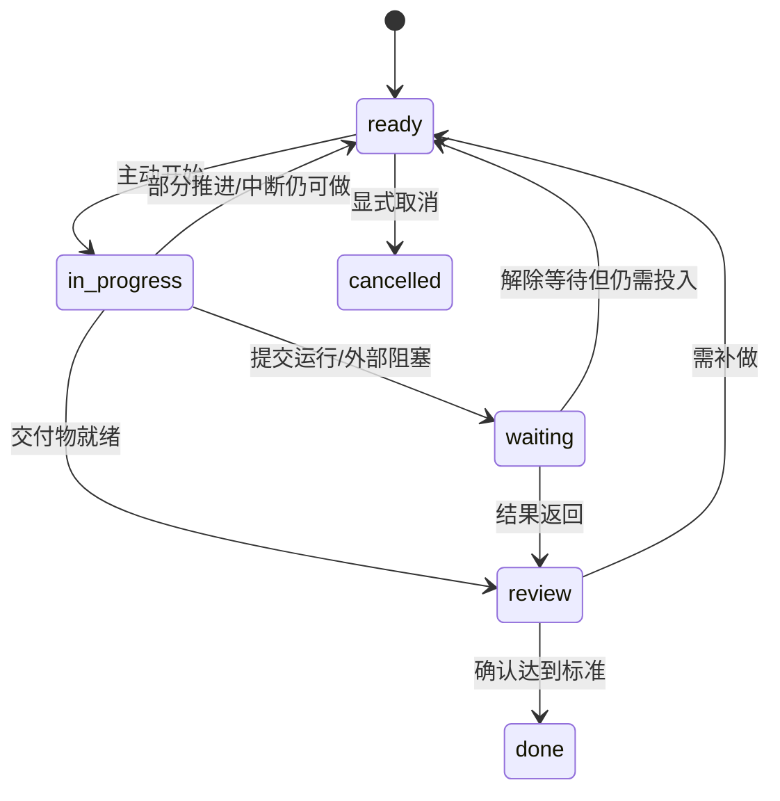

# 数据、状态机与 API 契约（设计）

以下均为待实现契约。

## 对象

| 对象 | 主要字段 |
|---|---|
| Project | id、name、color |
| Task | id、project_id、title、outcome_criteria、remaining_minutes、deadline、min_chunk_minutes、splittable、state、version |
| Dependency | predecessor_id、successor_id；有向无环，前置完成标准明确 |
| TimeBlock | id、task_id（保护块可空）、start/end、timezone、kind(flexible/fixed/protected)、resource_id、version |
| Session | id、block/task/device_id、state、actual_start/end、active_intervals、version |
| Feedback | session_id、choice、outcome_text、remaining_minutes、check_at、reason、created_at |
| WaitingCheck | task_id、check_at、description、resolved_at |
| PlanProposal | id、base_revision、expires_at、operations、reasons、unscheduled_items、status |
| ChangeEvent | entity_id/version、device_id、operation_id、type、payload、recorded_at |
| Device | id、paired/revoked_at、last_seen、last_ack_plan_revision |
| Job/Report | 幂等键、触发时间、状态与重试；报告含来源范围、原文、版本和路径 |

时间点 UTC 保存，附 IANA 时区。重复作息按本地时间规则保存；日报日期由用户时区确定。

## 任务状态

in_progress/waiting/review 也可显式取消，但先关闭活动执行并保存事实。done 只通过显式重开返回 ready，定时事件不改变完成状态。

## 执行和计划分离

TimeBlock 表达计划；Session 只在用户开始后创建。执行为 running / paused / awaiting_feedback / closed。

| 事件 | 变化 | 约束 |
|---|---|---|
| 开始 | 创建 running | 在线最多一个 running/paused；计划时间与实际时间分别保留 |
| 暂停/恢复 | running ↔ paused | 暂停不计投入 |
| 到点/结束 | → awaiting_feedback | 结束活动区间，Task 不自动 done |
| 完成反馈 | Session closed，Task review→done | 保存快捷确认或结果说明及声明来源 |
| 部分完成 | closed，Task ready | 更新余量，下一段经排程产生 |
| 等待结果 | closed，Task waiting | 检查点明确，个人时间释放 |
| 被打断 | closed，Task ready/waiting | 原因决定仍可做或外部阻塞 |

未开始计划可以 skipped 并反馈「尚未开始」，不伪造执行。无回复保留待确认，不占后续活动锁。

## 排程规则

只修改未来弹性块。满足固定/保护/活动执行、依赖、资源、截止期、最小连续块与拆分约束。等待运行不占个人时间；检查结果需要明确安排检查块。

初版排序：最晚可开始时间/截止期 → 用户优先级 → 保持原计划 → 减少碎片；先利用空闲缓冲。不可行任务返回 unscheduled_items，不能突破硬约束。

预览有完整新旧时间、原因和余量；应用必须校验依据版本。撤销产生补偿事件，不删除实际历史。

## HTTP 草案

前缀 `/api/v1`，写操作带 operation_id；更新带预期版本。配对后使用可撤销设备凭证。

| 方法/路径 | 职责 |
|---|---|
| POST /pairing/requests、/pairing/confirm | 短期一次性配对，电脑批准，返回设备凭证 |
| POST /tasks、PATCH /tasks/{id} | 任务、标准、估时与约束 |
| GET /schedule?from=...&to=... | 窗口和 plan_revision |
| POST /sessions/start、/sessions/{id}/pause、/resume、/end | 执行状态转换 |
| POST /feedback | 结果、余量、原因和检查点 |
| POST /plan/proposals、/plan/proposals/{id}/apply | 生成预览与原子应用 |
| GET /sync?cursor=...、POST /sync/operations | 增量读取和离线幂等提交 |
| POST /assistant/messages | 结构化提案，不能绕过校验 |
| POST /reviews、GET /reports/{date} | 保存原文、读取报告版本 |

422 字段校验，409 版本冲突，401 未授权，403 撤销设备。统一错误 code/message/request_id，有字段错误时附 field_errors。

## AI 与同步

模型白名单：读取相关日程、草拟任务/反馈、请求排程预览。schema + 业务规则校验后，按权限确认再应用；事实、推测和建议分别记录。

客户端 UUID 幂等键重放返回原结果。离线双端执行重叠时保留双方事实并标记冲突，用户校正。电脑显示待手机同步，直到收到计划版本回执。定时和归档作业持久化、幂等重试。
